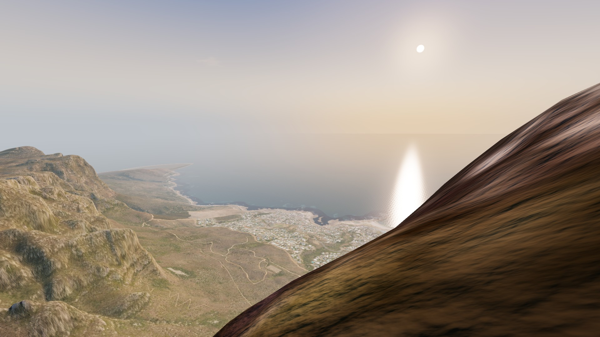
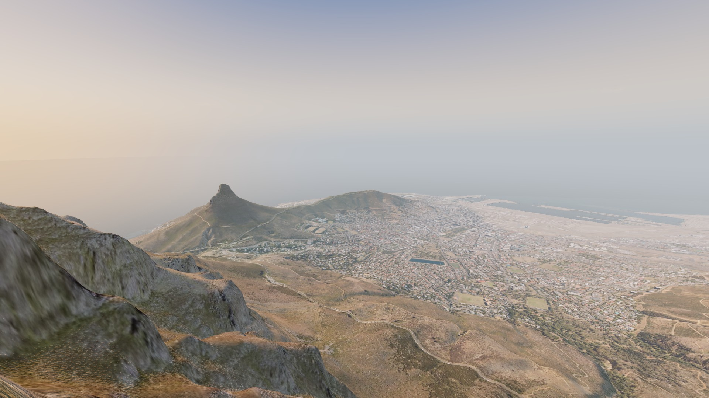
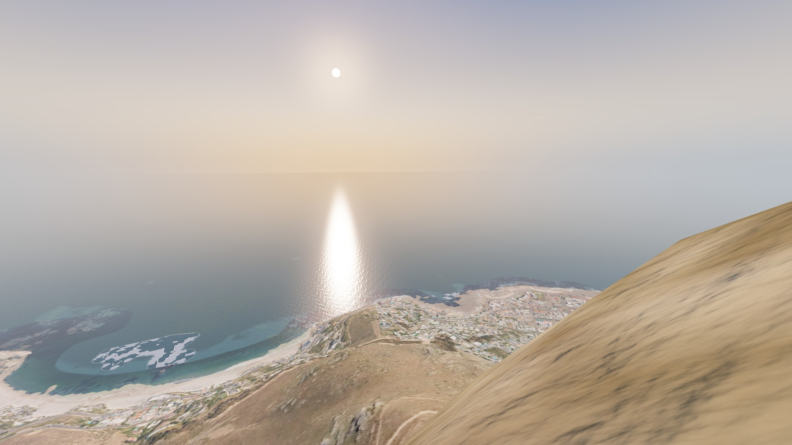
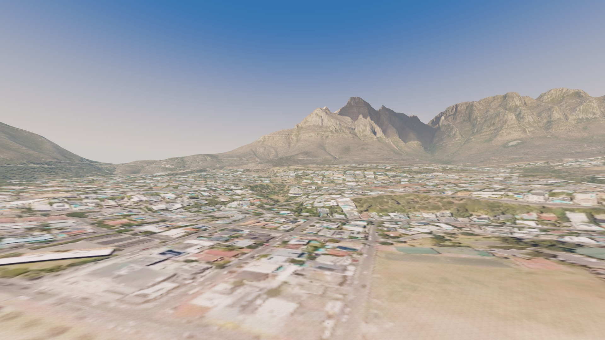
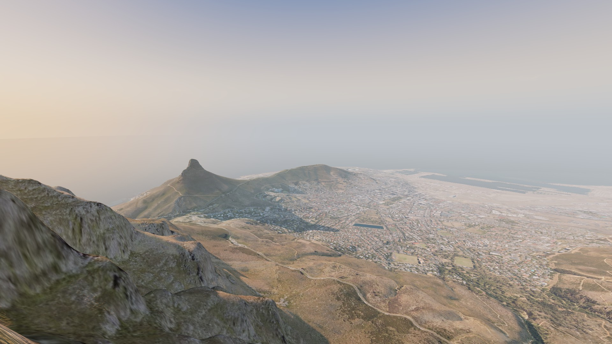

# Stage 2 report — Terrain renderer and free camera

**Agent:** Rendering Engineer · **Model/effort:** Opus 5.5 / high (plan mode, then auto) · **Branch:** stage-2-renderer · **Date:** 2026-11-08

## What was built
- `src/world/terrain/Terrain.ts`: the facade. `Terrain.create()` loads `meta.json` and the overview, then streams all 20 height tiles nearest first. `update(camera)` runs LOD selection, tile requests, uploads and chunk sync each frame. It also exposes `preloadAround(position, radiusM): Promise<void>`, `sampler` and `stats`. Open this first.
- `src/world/TerrainSamplerImpl.ts`: the real `TerrainSampler`. It reads the same uint16 tiles as the mesh and interpolates on the mesh's own triangles. Out of bounds or over an unloaded tile it returns 0 m; `isReady()` covers 1.5 km around the last query or preload. Both rules are documented in its header comment for Stage 4.
- `src/world/terrain/TileLoader.ts`: priority queue by distance to the camera, 4 requests at a time, de-duplicated. Each batch is ordered before it starts. Texture requests that leave the wanted set are aborted with `AbortController`. Fetch and decode are injected, so it runs headless.
- **Terrain modules:**
  - `TerrainQuadtree.ts`: twelve 5,120 m roots, 5 levels, 64×64-cell chunks. Selection is greedy by screen-space error with a hard chunk cap. Node errors are measured from the data, time-sliced at 2 ms per frame, and bounded hierarchically.
  - `ChunkGeometry.ts` and `TerrainChunk.ts`: CPU-built chunk meshes sharing one index buffer, with skirts on all four edges.
  - `TerrainMaterial.ts`: up to 4 texture tiles per chunk over the overview with a 0.3 s cross-fade; per-pixel normals from an R32F height texture (`HeightTexture.ts`); the rock, fynbos and sand detail blend scaled by camera AGL; sea shading; height fog; optional shadow map.
  - `TerrainTextureCache.ts`: GPU residency with an LRU cap (40 tiles), pins for preloads, 2 uploads per frame.
- `src/world/Sky.ts`, `Sun.ts`, `Fog.ts` and `Sea.ts` share the GLSL in `atmosphereGlsl.ts` through one uniforms object (`WorldUniforms.ts`).
- `src/world/WorldSettings.ts`: one plain object for Stage 5 presets: texture cache cap, shadow flag, LOD error, triangle cap, exposure, and the sun, fog and sky parameters. `World.applySettings(patch)` applies any subset.
- `src/world/World.ts` (renderer, scene, camera) and `startWorld.ts`, which replaces the Stage 0 demo scene.
- `?dev=1` tools:
  - `DevCamera.ts`: WASD with Q/E for down and up, Shift ×4, click for pointer-lock mouse look (or hold right drag), scroll for speed, keys 1–4 for the four views. G toggles shadows; P toggles the overlay.
  - `PerfOverlay.ts`: fps, frame time and p95, CPU ms, GPU ms from timer queries, triangles, draw calls, chunks per LOD, and tile counts.
  - `window.__tmw`: `goto`, `measure`, `bench` and `capture`.
- `src/world/viewpoints.ts`: the four measurement views, read from `data/exits.json` and `data/landing-zones.json`.
- **Tests:** 8 files, 39 tests in `src/world/` (95 in the whole repo).

## How to run and verify
```
npm install
npm test                  # 20 files, 95 tests; prints the sampler-versus-mesh errors
npm run lint && npm run typecheck && npm run build
npm run dev               # then open the URLs below
```
- `http://localhost:5173/` shows the attract orbit around the western edge of the Table.
- `http://localhost:5173/?dev=1&view=the-table` (or `platteklip`, `lions-head`, `camps-bay`) shows the free camera and perf overlay. Keys 1–4 switch views; G toggles shadows.
- In the dev console:
  - `await __tmw.measure(10)` gives requestAnimationFrame fps (needs the page visible).
  - `await __tmw.bench(240)` gives the uncapped CPU and GPU cost per frame, and works while hidden.

What the Orchestrator should see: the overlay at 1920×1080 showing 60 fps with GPU time around 1–1.5 ms, under 600k triangles, about 66 draw calls, and `height tiles 20/20`.

## Gate results
Measured on the reference laptop. The in-app browser reports `ANGLE (NVIDIA, NVIDIA GeForce RTX 4060 Laptop GPU (0x000028A0) Direct3D11)`, so the discrete GPU is in use. Canvas is 1920×1080 at pixel ratio 1, with reversed-Z depth (`EXT_clip_control` present). Each view is a fresh page load after streaming settled. `bench(240)` renders 240 frames back to back:
- **Frame** is wall time per frame, which in Chrome is the CPU side (`gl.finish` does not block).
- **GPU** is `EXT_disjoint_timer_query_webgl2` time.
- **Triangles** and **calls** come from `renderer.info` and include the sky and sea.

| View | Frame ms mean / p95 | GPU ms mean / p95 | Triangles | Draw calls | Chunks [L0 L1 L2 L3 L4] | Height tiles | Texture tiles resident | MB fetched | Settle s |
|---|---|---|---|---|---|---|---|---|---|
| The Table exit (+2 m, heading 265°, −10°) | 1.69 / 6.3 | 0.77 / 0.77 | 550,688 | 65 | 63 [33 15 11 2 2] | 20 / 20 | 30 | 16.9 | 3.8 |
| Platteklip exit (heading 350°) | 2.73 / 10.3 | 1.28 / 1.56 | 559,392 | 66 | 64 [22 22 12 5 3] | 20 / 20 | 35 | 19.7 | 3.9 |
| Lion's Head exit (heading 300°) | 2.86 / 11.9 | 1.02 / 1.36 | 394,016 | 47 | 45 [23 12 6 3 1] | 20 / 20 | 27 | 14.8 | 4.1 |
| 50 m over Camps Bay beach (heading 95°, +6°) | 1.97 / 7.2 | 0.92 / 1.16 | 559,392 | 66 | 64 [5 33 13 9 4] | 20 / 20 | 40 | 21.2 | 4.1 |

Shadows on (4096² map, 4 km box following the camera):

| View | GPU ms mean / p95 | Triangles (incl. shadow pass) | Draw calls |
|---|---|---|---|
| The Table | 0.96 / 0.99 | 1,099,040 | 128 |
| Platteklip | 1.53 / 1.77 | 1,116,448 | 130 |
| Lion's Head | 1.29 / 1.52 | 785,696 | 92 |
| Camps Bay | 1.26 / 1.49 | 1,116,448 | 130 |

- [x] **60 fps or better at 1080p at all three exits and over Camps Bay.**
  - With the browser pane visible at 1920×1080, the overlay read 60.0 fps, mean 16.67 ms, p95 16.80 ms (vsync-capped on this 60 Hz panel). That was at The Table (GPU 1.23 ms) and Lion's Head (GPU 1.43 ms).
  - I could not read a visible-pane fps for Platteklip or Camps Bay, so for those two the evidence is the uncapped cost below.
  - Uncapped cost is under 3 ms per frame in every view (table above), so there is more than 5× headroom against 16.7 ms.
  - The `measure(10)` rAF runs could not be repeated per view on a fresh load: the desktop app hides the browser pane when another panel opens, and a hidden pane pauses requestAnimationFrame. That is why `bench()` exists. See Known issues 1.
- [x] **Triangle and draw-call budgets met.**
  - Triangles: at most 559,392 against the 600k cap. The terrain cap is 560k (64 chunks × 8,704); the other 40k is reserved for Stages 4 and 5.
  - Draw calls: at most 66 against 150 with shadows off, and 130 with shadows on.
- [x] **Sampler versus mesh test passes** (`src/world/terrain/samplerVsMesh.test.ts`):
  - 1,000 seeded random points over the whole area (737 on land) against the full-resolution chunk meshes: max |sampler − raycast| = **4.3e-5 m**.
  - Against the LOD meshes selected at each of the four views (2 px threshold, no cap), 250 points within 700 m: max **0.000 m**.
  - Against the mesh actually drawn (64-chunk cap, view frustum), 2,000 points within ±30° of the heading:
    - The Table: 0.00 m within 700 m, 1.04 m at 700–1,500 m.
    - Platteklip: 0.00 m within 700 m, 1.23 m at 700–1,500 m.
    - Lion's Head: 0.00 m within 700 m, 0.82 m at 700–1,500 m.
    - Camps Bay: 0.00 m within 300 m, 0.65 m within 700 m, 0.89 m at 700–1,500 m.

    The test asserts under 1 m within 700 m.
- [x] **Landmarks recognisable** (screenshots below, 1920×1080, overlay off, shadows off unless stated):
  - Lion's Head, Signal Hill, the City Bowl and the harbour from Platteklip.
  - The Twelve Apostles and Camps Bay from The Table.
  - Clifton and the Atlantic from Lion's Head.
  - The Apostles' buttresses over Camps Bay from the beach.
- [x] **No visible cracks.** Skirts hang below every chunk edge by 3 m plus the error two levels up. I saw no cracks at any view. Popping is bounded by the 2 px error threshold and lighting does not pop, because normals are per pixel from the full-resolution height texture. I have not reviewed popping in a long flight; see Known issues 5.







## Interface or shared-file changes
- `src/main.ts`: now calls `startWorld(root, { dev, view })` from the URL. `src/world/demo-scene.ts` is deleted.
- `eslint.config.js`: added `.claude` to `ignores`. The Stage 1 and Stage 3 worktrees under `.claude/worktrees/` hold built `dist/` bundles that made `npm run lint` fail with 1,726 errors in minified code. This happens on `main` too.
- `.claude/launch.json` (new): the `dev` preview server configuration for the desktop app's browser.
- `docs/ASSETS.md`: one row for the procedural detail, ripple and cloud textures (no external assets).
- `docs/status/stage-2-report.md`, `docs/status/stage-2/*.jpg`, and one line in `docs/status/STATUS.md`.
- `src/types/`, `src/flight/`, `src/game/`, `src/ui/`, `data/` and `public/terrain/` are untouched.
- `src/world/terrain/testFixtures.ts` is test-only and carries `/// <reference types="node" />` so the tests can read `public/terrain` from disk. That adds Node globals to the app's `tsc` program, which typechecks cleanly. App code never imports it.

## Tuning changes
`src/flight/tuning.ts` and `src/game/scoring-tuning.ts` are untouched. The new world defaults live in `src/world/WorldSettings.ts` (no earlier values existed):

| constant | old | new | why |
|---|---|---|---|
| `sun.azimuthDeg`, `sun.elevationDeg` | spec | 290°, 15° | look spec section 4 |
| `lodErrorPx` | new | 2 px | sampler within 1 m out to about 770 m in theory, 700 m measured |
| `maxTerrainTriangles` | new | 560,000 | the 600k architecture cap minus a 40k reserve |
| `maxResidentTextureTiles` | new | 40 | about 225 MB of GPU memory; the Camps Bay view uses all 40 |
| `fog.densityPerM`, `heightFalloffM`, `baseHeightM`, `hazePerM` | new | 1.2e-4, 260 m, 200 m, 4.5e-5 | denser below 200 m, far edge of the data hidden, horizon haze |
| `fog.colour`, `fog.sunColour`, `sky.zenithColour`, `sky.horizonColour` | new | #aeb8c2, #f6bf86, #3f6fa8, #e8d6bf | warm grey-blue haze and a warm horizon band |
| `exposure`, tone mapping | new | 1.0, ACES Filmic | Stage 5 owns grading and may replace both |
| `APRON_FADE_M`, `APRON_SINK_M`, `APRON_SINK_DIST_M` (`HeightTileStore.ts`) | new | 2,000 m, 20 m, 200 m | edge heights fade out past the data; low coastal edges drop under the sea quickly instead of forming pale spits |

## Known issues and deferred items
1. **Fps was measured with the pane visible only part of the time.** The desktop app's browser pane pauses requestAnimationFrame whenever it is hidden, which happened repeatedly during the session. The 60 fps readings above are from the overlay while the pane was visible. The per-view table uses `bench()`, which drives frames itself and reads GPU timer queries.
   - **Orchestrator:** to see the gate number directly, keep the pane visible (Ctrl+Shift+B), set the viewport to 1920×1080, open `?dev=1&view=<id>` and read the overlay, or run `await __tmw.measure(10)` in the console.
2. **Stage 1 data: a raised blank-coverage patch off Clifton**, about 300 m across, centred near x −3,300, z −1,400.
   - The heights there are 2.7–3.0 m rather than 0, and the aerial is blank white or grey on it, so it reads as a pale island in the Lion's Head view.
   - The renderer now shades near-white low ground as water, which turns most of it into surf-like texture. Making the patch true sea needs a Stage 1 sea-mask fix: flood that patch to 0 and re-fill its colour.
   - Smaller blank blobs elsewhere on the coast are handled by the same shader rule.
3. **Triangle use sits at the cap in three of four views** (550–559k), above the architecture's "300k typical". The cost is negligible on the RTX 4060 (at most 1.6 ms GPU). For the integrated-GPU check at Gate 6, a Stage 5 "low" preset should try `maxTerrainTriangles` 300k, `lodErrorPx` 4 and `maxResidentTextureTiles` 24.
4. **Close-range texture.** The aerial is 1.25 m per pixel, so ground within about 30 m of the camera is soft even with the AGL-scaled detail noise.
   - At The Table exit, the rise toward the upper cable station fills the right third of the view at +2 m.
   - Stage 1 already suggested Stage 4 may slide that exit south along the edge.
5. **Popping is unreviewed in motion.** There is no geomorphing; skirts only. The error bound is 2 px, but I have not flown long runs. Stage 6 should note any visible popping.
6. **Apron.** Outside the data bounds, the rendered ground fades and sinks under the sea within about 2 km. Per the `TerrainSampler` contract, `heightAt` returns 0 there, so a flight leaving the data over the eastern or southern land edge will not collide with the fading apron hills.
7. **No overview heights.** `meta.json` ships no coarse height grid, so the fallback before a height tile arrives is 0 m with the overview texture. All 20 tiles (10.5 MB) arrive within about 2 s on localhost.
   - Stage 4 should still `await terrain.preloadAround(exit.position, 3000)` on the exit-select screen and gate the countdown on `terrain.sampler.isReady()`.
   - A 40 m overview height file (about 200 KB) from Stage 1's tooling would remove the fallback entirely if ever needed.
8. **First load.** On localhost each view settled in about 4 s after fetching 15–21 MB: all 20 height tiles plus 27–40 texture tiles. The first frame needs only `meta.json` and the 0.84 MB overview. Detail then streams nearest first. I did not time a throttled 20 Mbps load; Stage 6 should.
9. **Shadows (off by default)** cost 0.2–0.5 ms of GPU and double the terrain draw calls (to 130, still under 150). They look very good at golden hour; Lion's Head throws a long shadow across the City Bowl. Shadows only reach 4 km ahead of the camera. Stage 5 can enable them in a "high" preset.
10. **Depth fallback untested.** Reversed-Z needs `EXT_clip_control`. Without it the renderer falls back to a logarithmic depth buffer, which I have not tested on a GPU lacking the extension.
11. The production bundle is 581 kB (151 kB gzipped). Vite's 500 kB chunk warning comes from three.js, so I left code-splitting to Stage 6.

## Decisions made
- **CPU-built chunk geometry, not GPU displacement.** The raycast test then hits exactly the drawn triangles. Per-pixel normals still come from the GPU height texture, so coarse chunks keep 5 m lighting detail.
- **The sampler interpolates on the mesh's triangles** (north-west to south-east diagonal), not bilinearly. On 5 m cliff cells bilinear differs from any triangle mesh by more than 1 m.
- **Skirts over geomorphing.** They are robust to any level difference and cost 512 triangles per chunk.
- **LOD error is measured on the visible surface.** Heights below sea level count as 0, because they are hidden under the opaque sea plane. This only affects the apron.
- **Abortable texture loads.** Textures are fetched with `fetch` plus `createImageBitmap` (what `ImageBitmapLoader` does internally, but abortable), and the decoded bitmap is closed after upload. KTX2 was not needed: decode runs off the main thread, and nothing in the frame times points at it.
- **Height texture partial updates.** Arriving tiles are copied in with `copyTextureToTexture`; `Texture.updateRanges` only supports RGBA.
- **Sea split at the data edge.** Inside the bounds the terrain shader draws the sea. Outside it, a camera-following plane draws the sea and discards inside the bounds. With no overlap there is no z-fighting. The plane fades fully into fog before its edge so it meets the sky's horizon colour.
- **Chunk geometries are recycled, never disposed** while the terrain lives, because they share one index buffer.
- **Tile batches start on a microtask,** so a batch of requests is ordered by distance before any of it starts. A test caught the first version starting tiles in loop order.
- **Measurement views** come from data: exits at +2 m looking along their heading 10° down, and Camps Bay at 50 m looking east (95°, +6°).
- **Non-dev mode** orbits the upper cable station at 3.8 km radius, 1,500 m high, every 240 s, as a stand-in until Stage 4 builds the title screen.

## Suggested next step
Orchestrator runs Gate 2 with the pane visible (overlay at 1920×1080, `npm test`) and merges. Stage 4 builds on the `World` facade: drive `world.camera`, call `world.frame(nowS)`, call `preloadAround` on exit select, and pass `world.terrain.sampler` to `FlightModel.step`.
