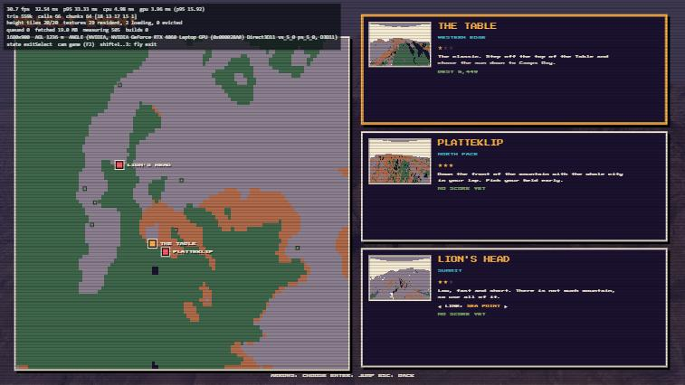
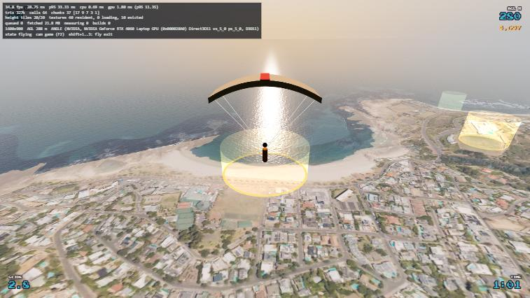
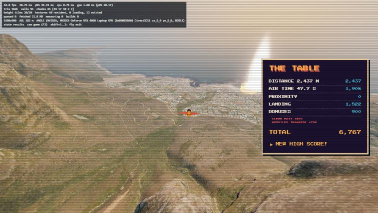

# Stage 4 report — Game loop, UI, scoring

**Agent:** Gameplay and UI Engineer · **Model/effort:** Sonnet 5.5 / high · **Branch:** stage-4-game · **Date:** 2026-11-08

## What was built
- **`src/game/Game.ts`** (open this first): owns the world, screens, input and the run, and moves through the states. One `tick(dt)` per animation frame; `advance(seconds)` drives frames without rAF (used for testing in a hidden pane).
- **`src/core/`**: `FixedStepLoop` (120 Hz accumulator, returns the render alpha, drops the backlog instead of spiralling), `InputManager` + `inputMapping` (keyboard with the 120 ms low-pass, pointer-lock mouse as a self-centring virtual stick, Gamepad API with deadzones and menu repeat), `Persistence` (versioned `tmw.<name>.v<n>` keys, corrupt or throwing storage falls back safely), `Settings`, `EventBus` (typed hooks for Stage 5 audio: `ui-move`, `ui-select`, `ui-back`, `countdown`, `tally-tick`, `fanfare`, `stamp`, `phase`, `state`, `run-end`).
- **`src/game/`**: `GameStateMachine` (architecture section 7 plus `highScores`; `paused` and `settings` overlays), `ExitRegistry` / `LandingZoneRegistry` / `TriggerRegistry` (validate the JSON with `file: $.path: expected X, got Y` errors, convert lat/lon through `src/world/geo.ts`), `RunController` (drives `FlightModelImpl`, crash / out-of-bounds (AOI + 200 m) / landing / water detection, 30 Hz `ReplayRecorder`, produces `RunResult`), `Scoring` + `scoring-tuning.ts` (all components and the seven bonuses), `Profile` (top-10 per exit, unlocks, best run with replay), `Replay` (pack / unpack / player), `CameraRig` (chase, head, canopy, landing, intro flyover, title orbit; pure maths, no Three.js), `Autopilot` (dev and tests).
- **`src/ui/`**: one module per screen on a tiny `Screen` base (`show` / `hide` / `update` / `handleNav`): title with disclaimer and 30 s attract hook, high scores, exit select (posterised overview map, one card per exit from the registry, padlocks, alternate-heading picker), intro, countdown, HUD, pause, results (wipeout card, counting tally, per-100-point ticks), initials entry, settings. `ui.css` carries the palette tokens, 4 px borders, 6 px hard shadows, stepped animation only, `prefers-reduced-motion`, scanlines on the 2D layer outside live flight.
- **`src/fx/PlayerAvatar.ts` and `ZoneMarkers.ts`** (new, see interface changes): a low-poly wingsuit pilot that swings under a canopy on deploy, and draped rings plus a faint wall at each landing zone (recommended zones of the chosen exit in the accent colour).
- **Data:** `data/triggers.json` (Platteklip gorge, three Apostles volumes), refined `data/exits.json` (positions, headings, three-point intro camera paths), `public/img/exit-<id>.png` card pictures.
- **Tools** (`tools/`): `exit-check.ts` (autopilot flies each exit headless over the real height tiles), `exit-search.ts` (searches around an exit for a start arc that clears the terrain), `exit-profile.ts`, `track.ts`, `flowlines.ts`, `heightmap-ascii.ts` (used to find the gorge), `gorge-check.ts`.
- **Tests:** 82 new tests in `src/core/core.test.ts`, `src/game/{registries,scoring,game,camera}.test.ts` (loop, input mapping, persistence, registries and bad files, every score component and bonus, state transitions, run end cases including water and out-of-bounds, replay round trip, high score persistence, camera rules). 177 in the repo.

## How to run and verify
```
npm test && npm run lint && npm run typecheck && npm run build
npm run dev                       # http://localhost:5173/
npx tsx tools/exit-check.ts       # headless autopilot flight per exit and zone
```
- Play: `/` → JUMP → The Table → fly. Controls: W/S dive and pull up, A/D bank, Q/E yaw, Space deploy then (fresh press) flare, Shift brake, C camera, R restart, Esc pause; click the canvas for mouse; pad: stick, triggers, A, LB, Start.
- `?dev=1`: perf overlay (P), free camera (F2, then DevCamera keys), Shift+1..N starts a flight at exit N, `window.__tmw.game`. `?dev=1&auto=1&exit=the-table` flies the whole run with the Autopilot (this is how the screenshots below were taken). `__tmw.fly('platteklip', false)` and `__tmw.advance(seconds)` drive it from the console.

## Gate results
Full-run evidence: [complete-run.gif](stage-4/complete-run.gif) (11 frames of one autopilot run: title, exit select, countdown, exit, wingsuit, Apostles stamp, canopy over Camps Bay, landing cam, tally, results, initials). Individual frames are in `docs/status/stage-4/`.





- [x] **Full loop for all three exits without a console error.** Title, exit select, intro, countdown, exit, wingsuit, deploy, canopy, landing, results, initials, high score table, back to title, all driven in the browser; the console showed no errors in dev or plain mode. Headless: `tools/exit-check.ts` clears the start arc of all three exits (and both Lion's Head lines) over the real terrain; the autopilot landed The Table in the Camps Bay zone 7 m from centre (score 6,767: clean exit, Apostles traverse, soft landing).
- [x] **Crash, out-of-bounds and water landing have result screens.** Hands-off run from Platteklip crashed at 62.7 s: WIPEOUT card, tally with distance halved. Out-of-bounds and water are covered by unit tests with the stub terrain (`game.test.ts`) and have their own card text ("OUT OF BOUNDS", water-suit joke). I did not fly an out-of-bounds or water run through the browser.
- [x] **Exits and zones only from `data/`.** The UI builds cards and pins from `ExitRegistry`; a test parses a fourth exit and the registry accepts it. A fourth exit with no picture falls back to the gradient card image. I did not add a fourth exit to the file and look at it in the browser.
- [x] **High scores persist across reload.** `tmw.scores.v1`, `tmw.progress.v1` and `tmw.best.v1` (350 kB with replay) survived reloads; unlock of Platteklip and Lion's Head followed the first landing.
- [~] **Gamepad works.** Verified with a mocked `navigator.getGamepads` pad (menu stick and A, analog flight axes, trigger yaw, Start pause, B resume). No physical pad was available. Mouse pointer lock was not exercised (the preview pane is throttled and cannot take pointer lock); the mapping is unit-tested.
- Performance (not a Stage 4 gate, measured anyway): at 1600x900 in flight the CPU plus `gl.finish` cost was 0.7 ms per frame once tiles had settled, 90 draw calls, about 553k triangles. The preview pane is throttled when this session is not on screen, so the Orchestrator should read the overlay with the pane visible for the real fps.

## Interface or shared-file changes
- `src/main.ts`: now boots `Game.create` instead of `startWorld` (`startWorld` is still exported and unchanged). `src/style.css` reduced to the font-face; `index.html`: removed the Stage 0 `#hud` div.
- `src/fx/PlayerAvatar.ts`, `src/fx/ZoneMarkers.ts`: new, in Stage 5's folder, because Three.js objects may only be created in `src/world/` and `src/fx/`. Stage 5 may restyle or move them.
- Game imports `DevCamera`, `PerfOverlay` and `measurementViewpoints` straight from `src/world/` (not through `index.ts`), and uses `world.terrain.sampler.peekHeight` and `tilesLoadedAround` (public on `TerrainSamplerImpl`) for the camera and the markers.
- `data/exits.json` and `data/triggers.json` are owned by this stage. `docs/ASSETS.md`: one row for the card pictures. `public/img/` (new).
- Nothing changed in `src/world/`, `src/flight/` or `src/types/`. The frozen `ExitDefinition` has no room for Lion's Head's two lines, so `ExitDef extends ExitDefinition` with `altHeadings` lives in `src/game/ExitRegistry.ts`. `RunResult` has no end reason, so `RunOutcome` in `RunController.ts` wraps it.
- No `src/flight` or `src/world` API was missing. One thing to know: `Terrain.preloadAround` waits on `requestAnimationFrame`, so in a hidden pane it never resolves; the countdown therefore waits for `sampler.isReady()` (hard gate) plus the preload promise, capped at 6 s.

## Tuning changes
| constant | old | new | why |
|---|---|---|---|
| `src/game/scoring-tuning.ts` | none | all spec values | New file, numbers straight from `docs/design/scoring.md`; no balance change. Only addition: `landing.waterHeightM` 0.25 m (sea is exactly 0 in the DEM) and `soft/ok/hard` multipliers keyed by the flight model's classes. |
| `src/flight/tuning.ts` | | | Untouched. |

Camera numbers are in `CAM` at the top of `CameraRig.ts` (spec values: 0.25 s / 0.12 s lag, FOV 70 to 85, shake above 60 m/s).

## Known issues and deferred items
Stage 6 unless noted.
1. **Exit positions moved more than "a few metres".** On the 5 m DEM none of the original spots clear the start arc (60 m lost in about 4 s needs a drop steeper than the terrain gives near them). `tools/exit-search.ts` found spots whose arc clears with at least 7 m (Table), 8 m (Platteklip) and 4 m (Lion's Head) under both a hands-off and a modest-dive pilot. Moves: The Table 145 m north-north-west along the edge (y 1,044.8 m, heading 265 kept); Platteklip 168 m west (y 1,029.4 m, heading 350 kept); Lion's Head 15 m, Sea Point line turned from 300 to 275 degrees (300 hits the slope), Clifton line 240 kept (y 641.3 m). Lion's Head is the tightest; Stage 6 should fly it by hand.
2. **Triggers are authored from terrain data and an autopilot, not flown by a person.** The gorge box (x -120..70, y 610..860, z 760..960) follows the steepest-descent gully found by `tools/flowlines.ts`; `tools/gorge-check.ts` confirms scripted dive lines reach it. The three Apostles boxes sit along the Table to Camps Bay line (the autopilot gets the bonus). Their difficulty and the real Apostles geometry need a human balance pass.
3. **Visual checks I could not make.** The preview pane was throttled, so CSS animations (pop, blink, stamp slide, countdown slam) were verified only as their end states, and the 2D motion rules (steps only) were not seen moving. Mouse capture was not tried.
4. **Camera:** at ledges below a wall the chase camera pulls in toward the pilot; the intro ends on the plain start pose, so the cut to the countdown can jump by a few metres at The Table and Platteklip. Landing cam is a ground tripod ahead of the pilot; the collapsed canopy reads as a dark slab from low angles (emissive raised, not re-checked).
5. **Results background is a basic chase replay, looped.** Cinematic ground cams and the VHS look are Stage 5; here "VHS overlay" is a static CSS scanline layer on the 2D screens, toggled in settings. The attract mode plays the best stored replay after 30 s idle on the title, and any input ends it.
6. **Settings:** the audio sliders persist but nothing reads them (Stage 5). `SettingsScreen.addRow` is the hook for new rows. Quality presets map to `World.applySettings` (low 300k triangles, lod 4 px, 24 textures; medium the Stage 2 defaults; high adds shadows).
7. **Perf overlay covers the speed readout in `?dev=1`.** Dev only.
8. **Bundle** is 686 kB (185 kB gzipped); code-splitting and the absolute `/fonts/` URL in `style.css` (base path) are Stage 6.
9. **Flight model carry-overs from Stage 3:** a no-flare canopy landing is a crash by the phase table (a hard landing at over 9 m/s forward); the HUD clamps glide to "--" above 15 and when sink is under 0.5 m/s.
10. Scores are saved only when initials are entered (the arcade way); a run that does not make the top ten has no entry screen, its best-run replay is still kept if it beats the stored one.
11. `npm audit` advisories unchanged.

## Decisions made
- **Pitch keys:** W pushes the nose down (dive) and S pulls up, like a stick; arrows mirror them; the settings toggle inverts. Mouse: move down to pull up. Pad: stick forward dives.
- **Flare needs a fresh Space press after deploy** (`RunController.stepRaw`), so holding Space through the opening cannot burn the flare early. Edge-triggered deploy is left to the model.
- **Flow after a run:** results tally, then NEW HIGH SCORE leads to initials and then the high score table with JUMP AGAIN / CHANGE EXIT / TITLE; a run that does not qualify gets those three buttons on the results panel. JUMP AGAIN skips the intro.
- **A run is "completed" (unlocks exits) when it ends landed, including a water landing;** crashes and out-of-bounds do not count.
- **Out-of-bounds is scored like a crash** (`RunResult.crashed` true, distance halved, no landing score) with its own card text.
- **Water** is ground at or below 0.25 m, checked before zones, so the sea part of the Camps Bay circle scores nothing.
- **Landing accuracy** is added as spec'd (not softness-scaled); a crash gets 0 landing. Bonus points are summed then capped at 3,000.
- **Clean exit:** half the peak-to-peak pitch input over the first 5 s at or under 0.6, awarded at 5 s.
- **Gorge** is one box whose top sits under the gully rims; **Apostles** are boxes passed in `order`.
- **Countdown** starts the simulation at GO and holds on "3" (LOADING TERRAIN) until `sampler.isReady()`.
- **Replay storage:** `[t, p, q, phase]` rounded rows per 30 Hz frame; best run per exit only.
- **Quality, camera shake, invert pitch and mouse sensitivity** live in `tmw.settings.v1`.

## Suggested next step
Orchestrator runs Gate 4 with the browser pane visible (fps, CSS motion, mouse capture, a physical pad) and flies each exit once by hand, especially Lion's Head, then merges. Stage 5 can subscribe to `Game.bus` for audio, replace the basic replay camera, and add its settings rows.
